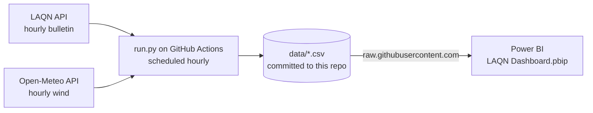

# London Air Quality Dashboard

**Python pipeline → CSV on GitHub → Power BI dashboard, refreshed automatically**

An end-to-end data project that collects live readings from the London Air
Quality Network (LAQN), stores them as CSV files in this repository through a
scheduled GitHub Actions workflow, and presents them in a multi-page Power BI
dashboard. The dashboard answers three questions: is the air OK today, when and
where is it worst, and can the data be trusted?

The Power BI project is in [`powerbi/`](powerbi/), saved as a Power BI Project
(`.pbip`), so its report and data model are plain text that can be reviewed in Git.

## The dashboard

| Page | Question | What's on it |
|---|---|---|
| **London now** | Is the air OK today? | Exceedance hours in the last 24h, sites reporting, recent spikes; a borough map shaded by exceedance hours; latest index by site, with a title naming the worst site; which pollutant drives each site's exceedances |
| **Trends: when** | When is it worst? | Exceedance rate over time with one panel per pollutant; a selected site or borough against the London average; exceedance rate by hour of day |
| **Trends: where & why** | Where is it worst, and why? | Week-on-week KPI for each pollutant; site map sized by exceedance hours, with a hover tooltip showing the last 24 hours; exceedance hours by borough and site type; roadside minus urban background over time |
| **Alerts** | What has spiked, and where? | Spikes in the period and in the last 7 days, the latest alert, and a log of flagged readings with z-scores |
| **Data quality** | Can I trust the data? | No-data share, share of hourly bulletins captured, active site-pollutant pairs, data age; valid readings per day against expected; sites with the most missing data |
| **Overview** | How is the pipeline doing? | Latest bulletin, total readings, hours captured, coverage, daily average by pollutant and missing data by pollutant. Also a drill-through target: right-click any site and choose **Drill through → Overview** |
| **About & method** | How was this built? | Data source, refresh, DAQI bands, metric definitions and known data gaps |

The analysis pages share slicers for borough, site type and pollutant, plus date
range, site and exceedance threshold where they apply, and the slicers stay in sync
across pages. Site bars and map points use the official DAQI band colours.

**As of 17 November 2026:** 61,175 readings over 68 days from 72 monitoring sites
in 21 boroughs, covering five pollutants (NO₂, PM2.5, PM10, O₃, SO₂). 55 of those
sites, in 17 boroughs, have returned valid values.

### Open it

1. Clone the repo, then open `powerbi/LAQN Dashboard.pbip` in a recent version of
   Power BI Desktop.
2. Click **Refresh**. The data loads straight from this repo's CSVs over HTTPS. If
   Power BI asks for credentials, choose **Anonymous**.

To publish it with scheduled refresh, see [powerbi/README.md](powerbi/README.md#refreshing).
No gateway is needed because the sources are public URLs.

## How it works



1. **Collect.** A GitHub Actions workflow runs `run.py` on an hourly schedule and
   fetches the latest LAQN bulletin.
2. **Transform and store.** Nested JSON is flattened to one row per site,
   pollutant and hour, then appended to `data/readings.csv`. Rows already on
   file are skipped, keyed on the API's own bulletin time. Site names and
   coordinates go to `data/sites.csv`, and hourly wind and temperature for each
   site-hour go to `data/weather.csv`.
3. **Detect.** Each run flags spikes and near-misses (see definitions below) and
   logs each one once to `data/spike_alerts.csv`.
4. **Publish.** The workflow commits the CSVs back to this repo, and Power BI
   reads them from GitHub.

### Data model

`readings` is the fact table. It relates to `sites`, a `Calendar` table and
`weather` (joined on site and hour); `spike_alerts` relates to `sites`. A
`Site Species` table marks which site-pollutant pairs are active. The model has
79 DAX measures, kept for reference in [`powerbi/measures.dax`](powerbi/measures.dax).

### Definitions

- **DAQI bands**: 1–3 Low, 4–6 Moderate, 7–9 High, 10 Very High. An index of 0
  in the feed means no data and is excluded from every average.
- **Exceedance hours**: site-pollutant-hours at or above a chosen index (default 2).
  London sits close to 1 most of the time, so averages look flat; exceedance
  counts show where and when the air is relatively worse.
- **Active pair**: a site and pollutant with a valid reading in the 7 days before
  the latest bulletin. No-data and completeness figures only count active pairs,
  so closed sites and pollutants a site never measures don't distort them.
- **Spike**: latest index ≥ 4 and above mean + 2 × standard deviation for that
  site and pollutant over the previous 24 hours, with at least 6 readings.
- **Near-miss**: latest index ≥ 2 and above mean + 1.5 × standard deviation.

## Known limitations

- **Coverage.** The LAQN feed only serves the latest bulletin, and GitHub delays
  scheduled runs, so the pipeline captures about 4–5 of the 24 hourly bulletins a
  day (about 19% so far). Counts are samples rather than complete totals. The
  Data quality and Overview pages track this.
- **Alerts rarely fire.** Spike detection needs at least 6 readings in 24 hours,
  which the current coverage seldom provides. Two spikes have been logged so far.
- **Index resolution.** DAQI values are coarse integers, so small differences
  (for example the roadside effect on NO₂) barely show. Concentrations in µg/m³
  would be needed for that.
- **Earlier data excluded.** Readings before 1 September 2026 came from an
  earlier version of the pipeline with unreliable timestamps, and are filtered out.
- **Wind data.** Wind and temperature are collected and loaded into the model,
  but no page visualises them yet.

## Repository structure

```text
London-Air-Data-Project/
├─ .github/workflows/collect.yml   # scheduled run: fetch, store, commit the CSVs
├─ data/
│  ├─ readings.csv                 # one row per site, pollutant and bulletin hour
│  ├─ sites.csv                    # site name, borough, type, lat/lon
│  ├─ spike_alerts.csv             # spikes and near-misses
│  └─ weather.csv                  # wind and temperature per site-hour
├─ powerbi/
│  ├─ LAQN Dashboard.pbip          # open this in Power BI Desktop
│  ├─ LAQN Dashboard.Report/       # report pages and visuals (PBIR)
│  ├─ LAQN Dashboard.SemanticModel/# tables, relationships, measures (TMDL)
│  ├─ README.md                    # model, pages, refresh and limitations
│  └─ measures.dax                 # readable copy of every measure
├─ src/
│  ├─ fetch_hourly.py              # LAQN API requests
│  ├─ transform.py                 # flatten nested JSON into rows
│  ├─ store_csv.py                 # append, dedupe and upsert the CSVs
│  ├─ weather.py                   # Open-Meteo wind for each site-hour
│  └─ alert_spikes.py              # spike and near-miss detection
├─ run.py                          # pipeline entry point
├─ run_pipeline.bat                # optional local run via Windows Task Scheduler
├─ migrate_sqlite_to_csv.py        # one-off import from the earlier SQLite version
└─ requirements.txt                # requests, python-dotenv
```

## Run the pipeline locally

```bash
pip install -r requirements.txt
python run.py
```

Settings live in `.env`: CSV paths, the LAQN group name, and the spike and
near-miss thresholds (`LOOKBACK_HOURS`, `Z_THRESHOLD`, `MIN_AQINDEX`,
`NEAR_MISS_Z`, `NEAR_MISS_MIN_AQINDEX`). The pipeline uses only `requests` and
`python-dotenv`, so it installs on any Python 3.

To run it on a schedule from your own machine instead of GitHub Actions, point
Windows Task Scheduler at `run_pipeline.bat`; output goes to `logs/pipeline.log`.
Run `git pull` first if the workflow is also running, so the two don't diverge.

## Skills demonstrated

- REST API ingestion and flattening nested JSON
- Idempotent, append-only CSV storage with deduplication
- Joining a second source (Open-Meteo weather) on site and hour
- Scheduled automation with GitHub Actions, at no cost
- Statistical alerting (z-score spikes with a near-miss tier)
- Power BI data modelling, DAX, dynamic titles, drill-through and tooltip pages
- Power BI Projects (PBIR and TMDL) under version control

## Data sources

- [London Air Quality Network API](https://api.erg.ic.ac.uk/AirQuality/help),
  Environmental Research Group, Imperial College London
- [Open-Meteo](https://open-meteo.com/) for hourly wind and temperature

## History

The first version stored data in SQLite and used a Streamlit dashboard. It was
replaced by this CSV and Power BI pipeline. If you have the old
`data/london_air.db`, `python migrate_sqlite_to_csv.py` imports its readings.
